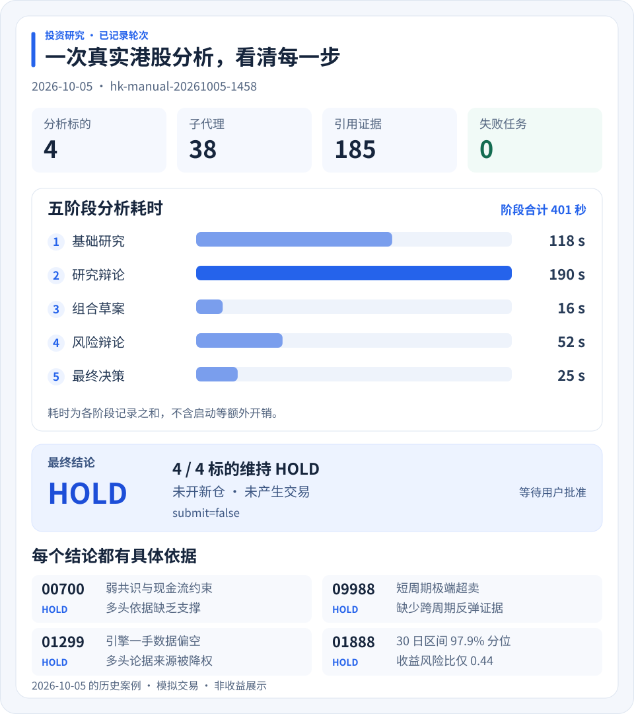
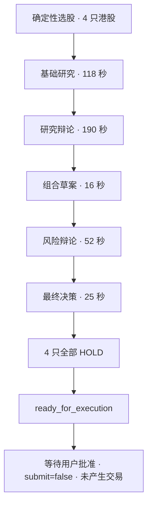

# AI 驱动多市场投资研究与模拟交易自动化系统

**AI-Driven Global Portfolio Optimization & Multi-Agent Trading Automation System**

[简体中文](README.md) | [English](README_EN.md)

[](https://github.com/Robertzsy/ai-trading-automation/releases/tag/v2.3.0)
[](LICENSE)
[]()

AI Trading Automation 是一款将**多因子量化筛选、组合优化与多智能体 AI 研究**结合的投资研究与**模拟交易**桌面应用，覆盖 A 股、港股、美股和场内 ETF。量化引擎负责计算与约束，AI 负责结合技术面、财务、新闻和情绪证据形成判断，Python 风控与模拟经纪负责检查和执行。

**量化回答“哪些标的值得研究、仓位如何配置”，AI 回答“投资逻辑是否成立、有哪些反证”，风控决定“这笔模拟交易是否允许执行”。**

2.x 基于 DeepSeek Harness（DSH）构建，提供总览、投资助手、投资研究和设置四个工作区。

最新版本 **2.3.0**：提升选股针对性、研究结论可执行性，并显著降低分析成本；新增条件观察、现金部署规则与投资总览界面更新。

> 本项目只支持研究与模拟交易，不连接真实券商，也不应直接用于真实资金决策。

## 目录

- [特性](#特性)
- [安装](#安装)
- [从源码运行](#从源码运行)
- [核心投资逻辑](#核心投资逻辑)
- [架构](#架构)
- [版本历史](#版本历史)
- [安全边界](#安全边界)
- [测试与发行](#测试与发行)
- [文档](#文档)
- [分支与兼容性](#分支与兼容性)
- [许可证](#许可证)

## 特性

- **四市场一站式**：A 股 / 港股 / 美股 / 场内 ETF 统一行情、选股、分析与模拟账户；T+1/T+0、整手、涨跌停、佣金、印花税、滑点等市场规则内建。
- **多因子量化筛选**：硬过滤 + 动量 / 相对强度 / 趋势 / 放量突破 / 加速度 / 风险调整动量 / 流动性 / 估值 / 低波动多因子评分，输出候选排序、因子分与筛选依据，权重与阈值可配置。
- **量化组合优化**：比较均值—方差、Black–Litterman、风险平价和成本调整方案，提供目标权重、现金比例、历史风险指标与调仓成本参考。
- **多智能体 AI 研究**：四路基础研究 → 多空辩论 → 研究裁决与逐股建议 → 组合草案 → 三方风险辩论 → 最终决策；结构化保存观点、异议、证据与检查点。
- **不可绕过的风控**：三档策略授权书、仓位封顶、回撤熔断、止损止盈内置；AI 决策必经 Python 硬风控与纸面撮合。
- **产品化桌面应用**：总览 / 投资助手 / 投资研究 / 设置四个页面；一键安装、单实例、托盘、开机自启、覆盖升级保留数据。
- **持仓联动 Dashboard**：按市场和原币种查看账户与组合分布，点击持仓查看个股日线；支持走势线、K 线、时间范围、成本线、成交量、MA20 与成交日期，并标明行情来源和数据日期。
- **对话式 AI 助手**：保留 DSH 原生思考、流式输出、工具、Skills、计划与子代理能力；支持日志诊断与经用户确认的代码修复。

## 安装

- 下载 [v2.3.0 Release](https://github.com/Robertzsy/ai-trading-automation/releases/tag/v2.3.0) 中的 `AiTradingAutomation-Setup-x64.exe`
- 支持 Windows 10/11 x64；安装包内置 Python、Node.js、.NET 桌面运行时与 WebView2 兜底安装程序

校验文件：[AiTradingAutomation-Setup-x64.exe.sha256](https://github.com/Robertzsy/ai-trading-automation/releases/download/v2.3.0/AiTradingAutomation-Setup-x64.exe.sha256)。下载后可在 PowerShell 中计算安装包的 SHA-256，与校验文件比较：

```powershell
Get-FileHash .\AiTradingAutomation-Setup-x64.exe -Algorithm SHA256
```

程序默认安装到 `%LocalAppData%\Programs\InvestmentAuto`，用户数据保存在 `%LocalAppData%\InvestmentAuto`。覆盖升级保留账户、持仓、报告、配置、凭据和会话。

## 从源码运行

需要 Python 3.10+、Node.js 22+ 和 .NET 8 SDK（仅构建桌面壳时需要）。

```powershell
# 安装 Python 依赖
python -m venv .venv
.\.venv\Scripts\python.exe -m pip install -e .

# 终端 1：启动投资引擎
.\.venv\Scripts\python.exe -m engine.main serve

# 终端 2：启动 AI Trading Automation Web 产品壳
.\app\scripts\dev.ps1 -Port 4567
```

然后访问 `http://127.0.0.1:4567`，在设置页配置模型与 API Key。

## 核心投资逻辑

系统把投资过程拆成可计算的筛选与配置、基于证据的 AI 研究，以及受约束的模拟执行。

```text
行情与历史数据 → 硬过滤 → 多因子候选排序
                                  ↓
财务、新闻与情绪证据 → 多智能体研究与辩论 → BUY / SELL / HOLD + 目标权重
                                                       ↓
                                      授权书与硬风控 → 模拟撮合 → 报告与执行记录

组合优化器：独立提供权重、风险与成本方案，供助手读取和对照解读。
```

| 层次 | 已实现的方法 | 输出与作用 |
|---|---|---|
| 量化筛选 | 价格、成交额、市值、估值与名称规则过滤；多因子加权评分 | 缩小研究范围，保留因子分、筛选依据与拒绝原因统计 |
| 组合配置 | 均值—方差最大夏普采样、Black–Litterman、风险平价、成本调整 | 比较目标权重、现金比例、历史收益与波动、VaR / 尾部损失及调仓成本 |
| AI 研究 | 技术面、基本面、新闻、情绪四路研究，多空辩论与组合风险裁决 | 综合数值信号和事件背景，提出动作、目标权重、理由与证据引用 |
| 风控与模拟执行 | 仓位、现金、换手、置信度、止损止盈、回撤与市场交易规则 | 检查 AI 建议，限制或拒绝订单，并记录模拟成交与拒绝原因 |

**两者如何协同**：量化高分意味着优先研究；AI 继续审查趋势是否得到基本面与事件支持、是否存在反证，再形成组合建议。即使建议 BUY，也必须通过执行层检查；条件不足可以 HOLD。组合优化结果是独立的配置参考，固定研究工作流不会自动采用其推荐权重。

当前多因子权重属于可配置规则；AI 的置信度是研究判断，不能当作经统计校准的上涨概率。组合优化指标来自历史样本估计，本项目尚未提供完整“选股—AI 决策—执行”策略经样本外验证的收益证明。

因子计算、组合优化假设、角色分工与执行边界见 [投资逻辑详解](docs/INVESTMENT_LOGIC.md)。

### 一个真实用例

以下是 2026-10-05 一次港股轮次的完整记录（轮次 `hk-manual-20261005-1458`），标的来自确定性选股：

[](docs/assets/hk-case-study.zh.svg)

点击图可放大。耗时为各阶段记录之和，不包含启动等额外开销；这张图展示分析过程与决策结果。

<details>
<summary>展开五阶段流程与原始轮次记录</summary>



| 环节 | 实测 |
|---|---|
| 输入 | 选股筛出 4 只港股：`01888`、`00700`、`09988`、`01299` |
| 过程 | 5 个阶段 · 38 个子代理 · **0 个失败** · 185 条引用证据 |
| 阶段耗时 | 基础研究 118s → 研究辩论 190s → 组合草案 16s → 风险辩论 52s → 最终决策 25s |
| 结果 | 4 只**全部 HOLD**，未开新仓 |
| 终态 | `ready_for_execution`（等待用户批准；本次 `submit=false`，未产生交易） |

</details>

<details>
<summary>展开四只股票的判断依据</summary>

四只标的都给出了可核验的具体理由，而不是笼统的「观望」：

- **`00700`** — 研究经理弱共识 0.62，低于建多所需把握；空头因果链时点吻合（业绩发布 → 次日放量破位 → 大行下修）；基本面「偏多」缺乏支撑（Q2 经调整净利 +9% 低于营收 +11%，上半年资本开支同比 +82%）；唯一正向事实（回购、大行目标价）已被自由现金流转负反向限定。
- **`09988`** — 研究经理看空 0.66 高于建多阈值 0.55，但该阈值只约束建多，看空不构成入场依据；MA60 / MA250 高悬于现价，短周期极端超卖（RSI6 18.92）而中周期中性（RSI14 49.03），抢反弹缺跨周期证据。
- **`01299`** — 空头主线锚定引擎一手数据且自洽（跌破全部均线、创 120 日收盘新低、MACD 负柱扩张、下跌放量）；多头承重墙落在非引擎接口与推算值上，方法论降权。
- **`01888`** — 入场价处 30 日区间 97.9% 分位，量价未确认（当日量 49.82M 低于量能 MA10 62.37M）；结构止损空间 −12.4%，盈亏比仅 0.44；「8–10× 前瞻 PE」为反推值，不可核验。

</details>

> 本轮在证据不足时维持 HOLD：38 个子代理、185 条证据完成分析后，四只标的均未开新仓，保留等待批准的状态。证据门槛与硬风控约束每一次交易提交。

## 架构

```text
Windows WPF + WebView2
          │
AI Trading Automation 产品外壳
          │
DSH 对话 / 工具 / Skills / 子代理 / 工作流
          │  本机令牌保护的回环 HTTP API
Python 投资引擎
          │
行情、选股、组合、风控、模拟撮合、审计与调度
```

- `app/`：DSH profiles、preset、Skills、投资工具桥、固定工作流和产品 UI；
- `engine/`：投资事实、配置、分析轮次状态、硬风控、纸面经纪与调度；
- `windows/desktop/`：WPF/WebView2 桌面壳与进程生命周期；
- `installer/`：自包含 Windows 安装器；
- `tests/`：引擎、恢复、幂等、配置和桌面回归测试。

## 版本历史

| 版本 | 核心变化 |
|---|---|
| 2.3.0 | 选股针对性、研究可执行性、分析成本与投资总览界面更新。 |
| 2.2.1 | 投资研究工作区、本地股票推荐、失败恢复与修复确认。 |
| 2.1.5 | 持仓与个股走势联动，首页用例可视化。 |
| 2.1.4 | 界面可读性、分析进度与报告展示改进。 |
| 2.1.3 | 日志诊断与可靠性改进。 |
| 2.1.2 | 模拟交易保护与中断恢复改进。 |
| 2.1.1 | 分开选股和指定股票分析入口。 |
| 2.1.0 | 独立桌面界面与产品设置。 |
| 2.0.0 | 桌面应用与多智能体流程重构。 |

更新记录见 [中文更新日志](CHANGELOG.md) 和 [v2.3.0 发行说明](docs/RELEASE_NOTES_2.3.0.md)。

## 安全边界

IA 以 DSH `danger-full-access` 运行，在当前 Windows 用户权限范围内可以读取日志、修改项目源码、运行 PowerShell、测试和构建。系统级权限与交易权限彼此独立：

- 始终只使用模拟账户和纸面经纪；
- 手动提交仍需要用户批准；
- 所有决策必须通过 Python 授权书和硬风控；
- cycle id、决策指纹和账户内执行回执阻止重复成交；
- API Key 和 Webhook 使用 Windows DPAPI 保存，不写入普通配置或日志；
- headless 与角色子会话保存在独立内部 DSH Home，不进入用户会话栏。

## 测试与发行

发行前检查 Python、插件与桌面测试、生成文件、版本一致性、捆绑运行时及覆盖升级的数据保护。开发者可运行：

```powershell
powershell -ExecutionPolicy Bypass -File scripts\release-check.ps1
```

## 文档

- [投资逻辑详解](docs/INVESTMENT_LOGIC.md) · [Investment Logic (EN)](docs/INVESTMENT_LOGIC_EN.md)
- [2.0 架构](docs/ARCHITECTURE_2.0.md) · [引擎 API](docs/ENGINE_API.md) · [产品外壳](docs/PRODUCT_SHELL.md) · [应用侧说明](app/README.md)

## 分支与兼容性

- `dsch/2.0`：当前 2.x 开发与发布分支，也是仓库默认分支；
- `legacy-1x`（tag）：1.x 的最终状态，作为历史与回退参考。2.0 是完整重做，
  1.x 代码只作存档，不再维护，因此不再单独占用一个分支；
- 1.x 用户数据可以迁移到 2.x，迁移与覆盖升级都不会删除源数据。

## 许可证

[MIT License](LICENSE)
