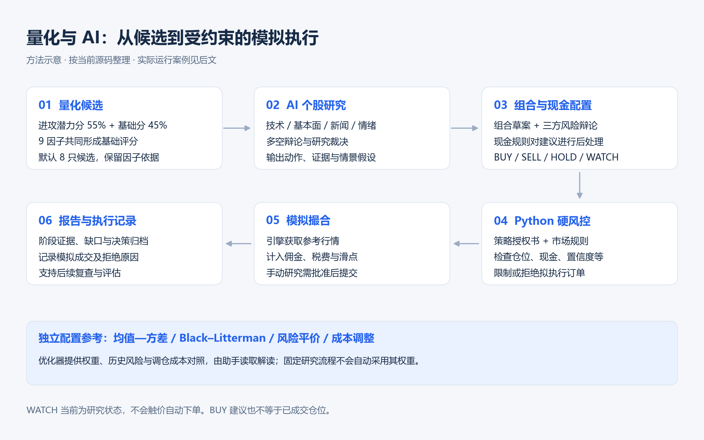
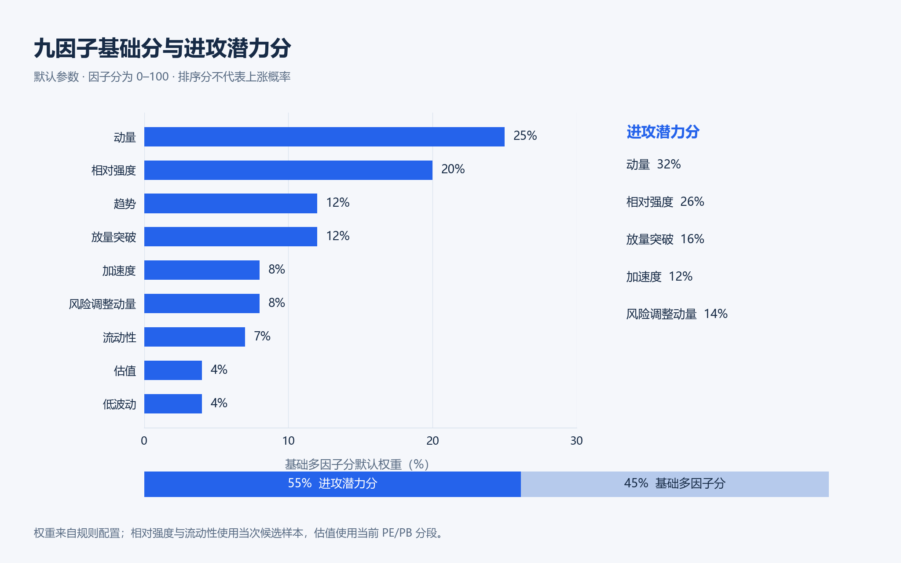
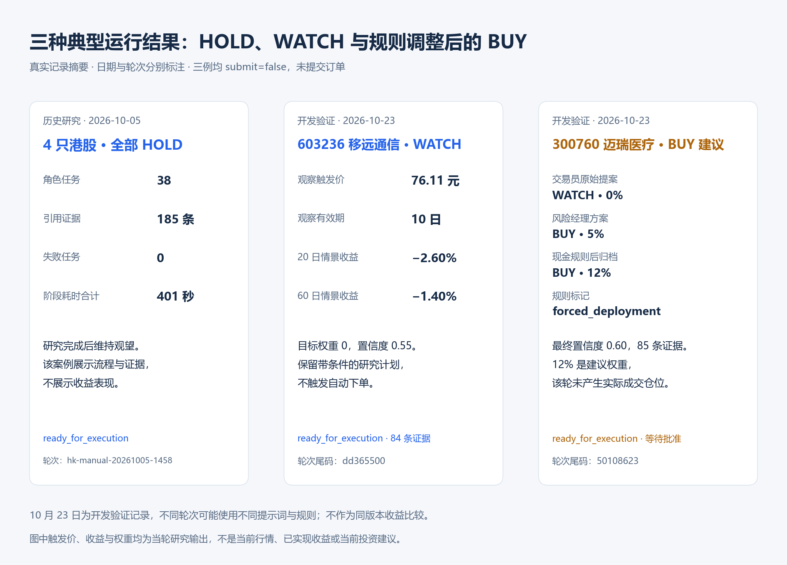
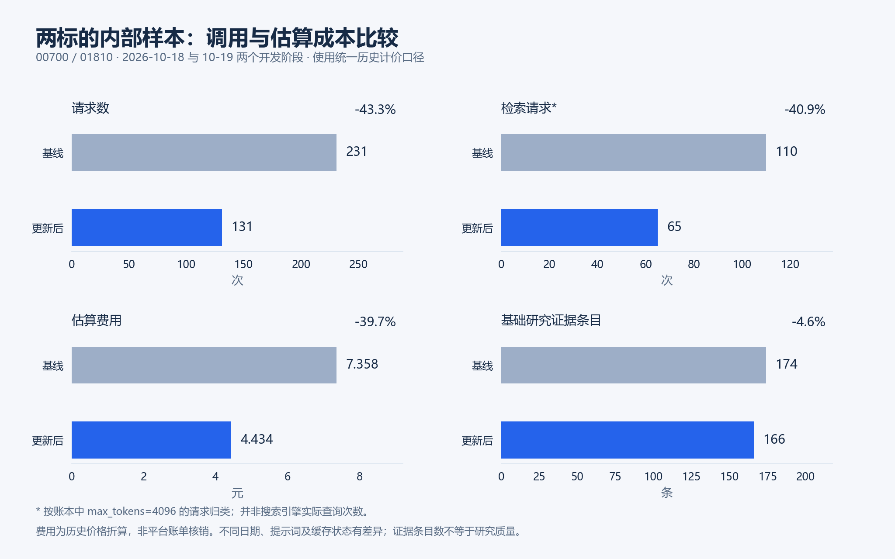

# AI 驱动多市场投资研究与模拟交易自动化系统

**AI-Driven Global Portfolio Optimization & Multi-Agent Trading Automation System**

[简体中文](README.md) | [English](README_EN.md)

[](https://github.com/Robertzsy/ai-trading-automation/releases/tag/v2.3.0)
[](LICENSE)
[]()

AI Trading Automation 是一款将**多因子量化筛选、组合优化与多智能体 AI 研究**结合的投资研究与**模拟交易**桌面应用，覆盖 A 股、港股、美股和场内 ETF。量化引擎负责计算与约束，AI 负责结合技术面、财务、新闻和情绪证据形成判断，Python 风控与模拟经纪负责检查和执行。

**量化回答“哪些标的值得研究、仓位如何配置”，AI 回答“投资逻辑是否成立、有哪些反证”，风控决定“这笔模拟交易是否允许执行”。**

2.x 基于 DeepSeek Harness（DSH）构建，提供总览、投资助手、投资研究和设置四个工作区。

最新版本 **2.3.0**：提升选股针对性、研究结论可执行性，并减少重复研究开销；新增条件观察、现金部署规则与投资总览界面更新。

> 本项目只支持研究与模拟交易，不连接真实券商，也不应直接用于真实资金决策。

## 目录

- [特性](#特性)
- [安装](#安装)
- [从源码运行](#从源码运行)
- [核心投资逻辑](#核心投资逻辑)
- [多因子与事件驱动选股](#多因子与事件驱动选股)
- [架构](#架构)
- [版本历史](#版本历史)
- [安全边界](#安全边界)
- [测试与发行](#测试与发行)
- [文档](#文档)
- [分支与兼容性](#分支与兼容性)
- [许可证](#许可证)

当前源码正在准备 **2.4.0**：多因子与事件驱动选股、日报公司事件接入、中英界面与研究输出，以及精确锁定的 DSH **0.2.1-rc.3**。上方下载链接仍指向已发布的 2.3.0。参阅下方[完整选股规则](#多因子与事件驱动选股)、[2.4.0 发行说明](docs/RELEASE_NOTES_2.4.0.md)、[语言支持](docs/LANGUAGE_SUPPORT.md)和[桌面使用说明](docs/DESKTOP_USAGE.md)。

## 特性

- **四市场一站式**：A 股 / 港股 / 美股 / 场内 ETF 统一行情、选股、分析与模拟账户；T+1/T+0、整手、涨跌停、佣金、印花税、滑点等市场规则内建。
- **多因子与事件驱动选股**：多因子评分叠加日报公司事件，按行业、事件和价格相关性减少研究名单中的重复；最多 60 只轻评估，形成前 20 名候选，再选 4—8 只完整研究，保留评分与原文依据。
- **量化组合优化**：比较均值—方差、Black–Litterman、风险平价和成本调整方案，提供目标权重、现金比例、历史风险指标与调仓成本参考。
- **多智能体 AI 研究**：四路基础研究 → 多空辩论 → 研究裁决与逐股建议 → 组合草案 → 三方风险辩论 → 最终决策；结构化保存观点、异议、证据与检查点。
- **不可绕过的风控**：三档策略授权书、仓位封顶、回撤熔断、止损止盈内置；AI 决策必经 Python 硬风控与纸面撮合。
- **产品化桌面应用**：总览 / 投资助手 / 投资研究 / 设置四个页面；一键安装、单实例、托盘、开机自启、覆盖升级保留数据。
- **持仓联动 Dashboard**：按市场和原币种查看账户与组合分布，点击持仓查看个股日线；支持走势线、K 线、时间范围、成本线、成交量、MA20 与成交日期，并标明行情来源和数据日期。
- **对话式 AI 助手**：保留 DSH 原生思考、流式输出、工具、Skills、计划与子代理能力；支持日志诊断与经用户确认的代码修复。

## 安装

- 下载 [v2.3.0 Release](https://github.com/Robertzsy/ai-trading-automation/releases/tag/v2.3.0) 中的 `AiTradingAutomation-Setup-x64.exe`
- 支持 Windows 10/11 x64；安装包内置 Python、Node.js、.NET 桌面运行时与 WebView2 兜底安装程序

校验文件：[AiTradingAutomation-Setup-x64.exe.sha256](https://github.com/Robertzsy/ai-trading-automation/releases/download/v2.3.0/AiTradingAutomation-Setup-x64.exe.sha256)。下载后可在 PowerShell 中计算安装包的 SHA-256，与校验文件比较：

```powershell
Get-FileHash .\AiTradingAutomation-Setup-x64.exe -Algorithm SHA256
```

程序默认安装到 `%LocalAppData%\Programs\InvestmentAuto`，用户数据保存在 `%LocalAppData%\InvestmentAuto`。覆盖升级保留账户、持仓、报告、配置、凭据和会话。

## 从源码运行

需要 Python 3.10+、Node.js 22+ 和 .NET 8 SDK（仅构建桌面壳时需要）。

```powershell
# 安装 Python 依赖
python -m venv .venv
.\.venv\Scripts\python.exe -m pip install -e .

# 终端 1：启动投资引擎
.\.venv\Scripts\python.exe -m engine.main serve

# 终端 2：启动 AI Trading Automation Web 产品壳
.\app\scripts\dev.ps1 -Port 4567
```

然后访问 `http://127.0.0.1:4567`，在设置页配置模型与 API Key。

## 核心投资逻辑

量化发现候选，AI检验投资逻辑，配置规则形成组合建议，代码风控约束最终模拟执行。



*上图为 2.3.0 流程概览；2.4.0 的候选与研究数量按下文规则执行。*

### 多因子与事件驱动选股

#### 候选如何进入研究名单

**市场候选＋日报公司事件 → 合并去重、统一筛选条件 → 最多 60 只轻评估 → 前 20 名候选 → 4—8 只完整研究。** 数量限制按每个市场的单次研究轮次计算。

- 市场发现列表和本地证券目录构成候选基础，已有可用的妙想来源继续补充；日报还可从本地目录召回市场发现列表以外的具体公司。所有来源均须通过用户设置的筛选条件。
- 在 60 个轻评估名额中，**量化候选保留至少 50 个名额，日报补充最多 10 个**。日报不足或与量化候选重合时，由量化候选补齐；同一证券只占一个名额。合格候选或行情不足时使用实际数量。
- “日报最多 10 个”指日报补充名额；已通过量化入围的股票仍可获得日报事件修正。
- 候选池、前 20 名名单和完整研究名单分别保存。60 只轻评估与前 20 名候选都不会整批进入多智能体完整研究。
- **持仓只作为组合和风险背景，不自动扩充研究数量。直接指定股票支持 1—8 只，跳过自动选股**，不再额外追加一批候选。

#### 评分与最终选额

保留原量化评分，以日报修正研究优先级：

```text
基础量化分 Q = 55% × 潜力分 + 45% × 综合因子分
综合分 S = Q + 日报修正 D，D 合计限制在 −15 至 +15 分
```

因子覆盖动量、相对强弱、趋势、量价突破、加速度、风险调整动量、流动性、估值和低波动；已有自定义因子权重继续生效。先按 S 排出前 20 名，再逐只选入研究名单：

1. 同行业每遇到一只已选标的扣 6 分；候选的主要事件与已选标的事件重复，每只扣 4 分；行业和事件扣分合计最多 12 分。
2. 高相关性扣分：使用最近最多 60 根日线，按相同交易区间对齐日收益，至少需要 30 个共同收益样本。设候选与已选标的的最大正相关系数为 ρ，扣分为 `8 × max(0, ρ − 0.75) / 0.25`。ρ 不超过 0.75 不扣分，ρ 为 1 时扣 8 分；负相关不扣分，样本不足保持未知。
3. 实际扣分取“行业/事件扣分”与“相关性扣分”的**较大值，不叠加**。研究优先级为 S 减去实际扣分，不强制一个行业只能选一只。
4. 先选 4 只，第 5—8 只与第 4 只的研究优先级差不超过 10 分才继续加入；**最多 8 只**。有效候选不足 4 只时不强行补足。

本方案保留原量化偏好与日报规则，只对高度重复的走势增加软扣分。筛选分数用于分配研究资源，后续仍经过基础研究、辩论、组合、风险复核和最终决策。

#### 日报如何参与筛选

- 对日报做公司实体级解读，识别具体公司、事件类别、影响方向和原文段落证据，再映射到已知证券。营收或利润增长、收入下降、转亏及监管事件等可影响研究优先级。
- **创始人个人财富缩水不再直接当作公司利空，单纯股价变化不当作经营事件。** 新品发布、评论等未确认经营影响的内容按中性处理；同一篇新闻可以对不同公司有不同方向。
- **同一公司、同一事件的多篇报道只计算一次**；方向冲突归为中性。原文证据由段落编号提取，ETF 简称不作为公司名称误匹配。
- 事件按重要性和时效加权，合计修正仍封顶 ±15 分。时效采用工作日近似：当日及下一工作日权重 1，第二工作日 0.65，第三工作日 0.35，更旧内容仅作背景；未来日期事件不提前使用。
- **同一份日报内容在同一规则版本下只解读一次并缓存，四个市场共用结果**；内容或规则版本变化后重新处理。并发请求共用进程锁，不让每只股票重复解读整份日报，读取缓存时重新计算时效衰减。
- 语义解读使用 DeepSeek 官方模型，请求包含公开新闻及证券名称、代码，不包含账户、持仓或私人研究。模型不可用时保留量化筛选，未确认的词典情绪不作为经营加减分；失败设置短暂重试间隔。
- 当前语义映射以具体公司为主，尚未覆盖完整行业和 ETF 成分关系；工作日时效也尚未使用交易所节假日日历。

#### 量化因子与研究参数



| 筛选与研究参数 | 默认配置与规则 |
|---|---:|
| 市场发现数量参数 / 快照预取上限 | 500 / 60只 |
| 量化保留名额 / 日报补充上限 | 至少50 / 最多10只 |
| 候选名单 / 单轮自动完整研究 | 最多20 / 4—8只 |
| 直接指定股票 | 1—8只，跳过自动选股 |
| 选股刷新周期 | 30分钟 |
| 基础研究角色 / 标的研究成功比例门槛 | 4类 / 80% |
| 默认研究辩论 / 风险辩论 | 各1轮 |

分数来自可配置规则，不代表上涨概率。组合优化器另提供均值—方差、Black–Litterman、风险平价和成本调整参考；默认回看参数120日、搜索采样参数3,000，单次最多12只标的。固定研究流程不会自动采用其推荐权重。

### 真实运行案例



- **港股完整研究（2026-10-05）**：38个角色任务、185条证据、0个失败，四只股票最终均HOLD，阶段合计401秒，不含启动等额外开销。
- **移远通信603236（2026-10-23，开发验证）**：WATCH，触发价76.11元、有效期10日、目标权重0%，20日/60日情景收益为−2.60%/−1.40%。
- **迈瑞医疗300760（2026-10-23，开发验证）**：交易员提案WATCH 0% → 风险经理BUY 5% → 经现金规则处理后归档BUY 12%，最终置信度0.60，保留规则调整标记。

三轮均为 `ready_for_execution`、`submit=false`，没有提交订单。图中价格、收益与权重是当轮研究输出；BUY建议不等于成交仓位，WATCH当前不会触价自动下单。历史与开发案例不作为同版本收益比较。

完整轮次、案例字段、策略参数与执行边界见[投资逻辑详解](docs/INVESTMENT_LOGIC.md)，数值见[最小化案例摘要](docs/assets/quant-ai-cases.json)。

### 调用与估算成本的内部样本



00700/01810两标的样本中，请求数231→131；按统一历史计价口径复算，估算费用¥7.358→¥4.434；基础研究证据条目174→166。两次运行日期、提示词及缓存状态不同，费用不是平台账单核销，证据数量不证明质量等价。比较范围与原始token汇总见[详解](docs/INVESTMENT_LOGIC.md#内部效率样本账本中的请求证据和费用)及案例摘要。

Python执行层独立检查策略授权书、仓位、现金、换手、置信度及市场规则。模型意见和现金规则都可能改变研究建议，最终成交仍受执行检查约束。

## 架构

```text
Windows WPF + WebView2
          │
AI Trading Automation 产品外壳
          │
DSH 对话 / 工具 / Skills / 子代理 / 工作流
          │  本机令牌保护的回环 HTTP API
Python 投资引擎
          │
行情、选股、组合、风控、模拟撮合、审计与调度
```

- `app/`：DSH profiles、preset、Skills、投资工具桥、固定工作流和产品 UI；
- `engine/`：投资事实、配置、分析轮次状态、硬风控、纸面经纪与调度；
- `windows/desktop/`：WPF/WebView2 桌面壳与进程生命周期；
- `installer/`：自包含 Windows 安装器；
- `tests/`：引擎、恢复、幂等、配置和桌面回归测试。

## 版本历史

| 版本 | 核心变化 |
|---|---|
| 2.3.0 | 选股针对性、研究可执行性、分析成本与投资总览界面更新。 |
| 2.2.1 | 投资研究工作区、本地股票推荐、失败恢复与修复确认。 |
| 2.1.5 | 持仓与个股走势联动，首页用例可视化。 |
| 2.1.4 | 界面可读性、分析进度与报告展示改进。 |
| 2.1.3 | 日志诊断与可靠性改进。 |
| 2.1.2 | 模拟交易保护与中断恢复改进。 |
| 2.1.1 | 分开选股和指定股票分析入口。 |
| 2.1.0 | 独立桌面界面与产品设置。 |
| 2.0.0 | 桌面应用与多智能体流程重构。 |

更新记录见 [中文更新日志](CHANGELOG.md) 和 [v2.3.0 发行说明](docs/RELEASE_NOTES_2.3.0.md)。

## 安全边界

IA 以 DSH `danger-full-access` 运行，在当前 Windows 用户权限范围内可以读取日志、修改项目源码、运行 PowerShell、测试和构建。系统级权限与交易权限彼此独立：

- 始终只使用模拟账户和纸面经纪；
- 手动提交仍需要用户批准；
- 所有决策必须通过 Python 授权书和硬风控；
- cycle id、决策指纹和账户内执行回执阻止重复成交；
- API Key 和 Webhook 使用 Windows DPAPI 保存，不写入普通配置或日志；
- headless 与角色子会话保存在独立内部 DSH Home，不进入用户会话栏。

## 测试与发行

发行前检查 Python、插件与桌面测试、生成文件、版本一致性、捆绑运行时及覆盖升级的数据保护。开发者可运行：

```powershell
powershell -ExecutionPolicy Bypass -File scripts\release-check.ps1
```

## 文档

- [投资逻辑详解](docs/INVESTMENT_LOGIC.md) · [Investment Logic (EN)](docs/INVESTMENT_LOGIC_EN.md)
- [2.0 架构](docs/ARCHITECTURE_2.0.md) · [引擎 API](docs/ENGINE_API.md) · [产品外壳](docs/PRODUCT_SHELL.md) · [应用侧说明](app/README.md)

## 分支与兼容性

- `dsch/2.0`：当前 2.x 开发与发布分支，也是仓库默认分支；
- `legacy-1x`（tag）：1.x 的最终状态，作为历史与回退参考。2.0 是完整重做，
  1.x 代码只作存档，不再维护，因此不再单独占用一个分支；
- 1.x 用户数据可以迁移到 2.x，迁移与覆盖升级都不会删除源数据。

## 许可证

[MIT License](LICENSE)
