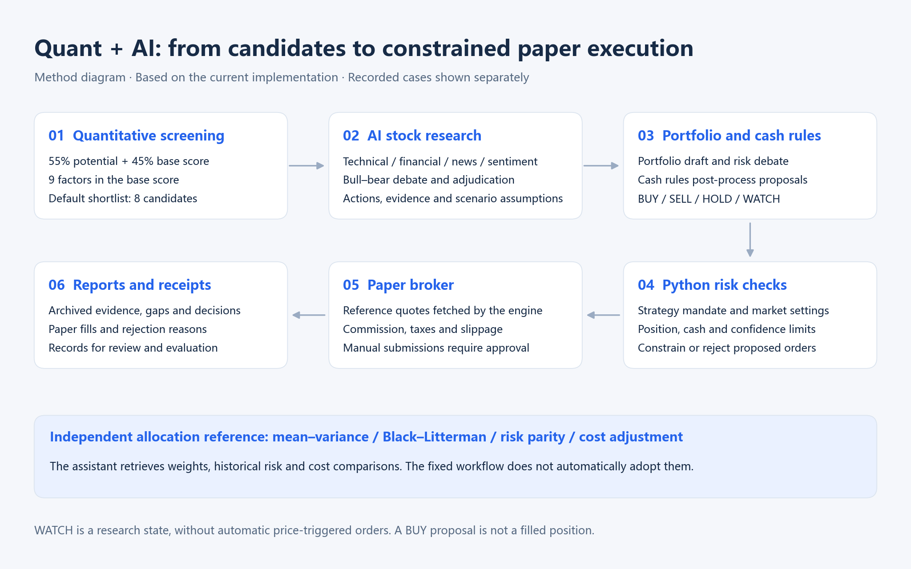
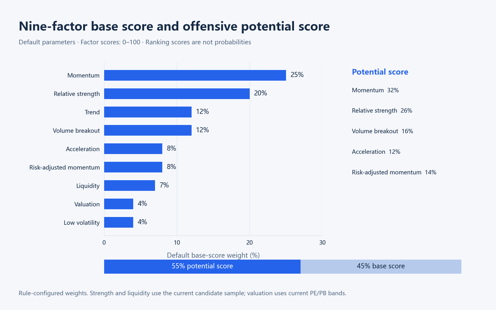
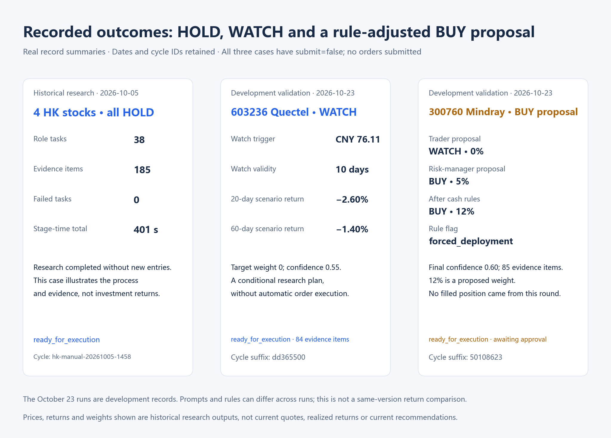
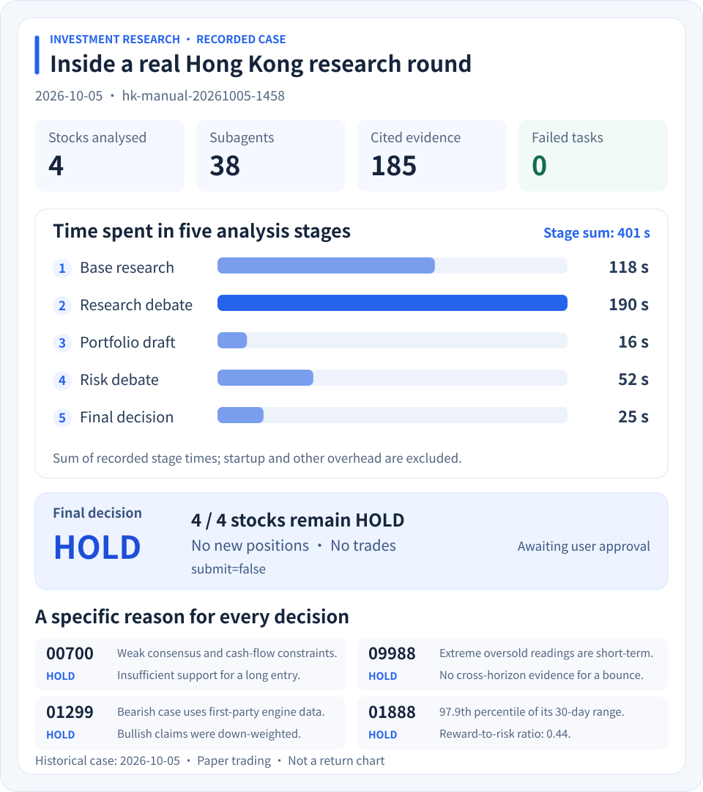
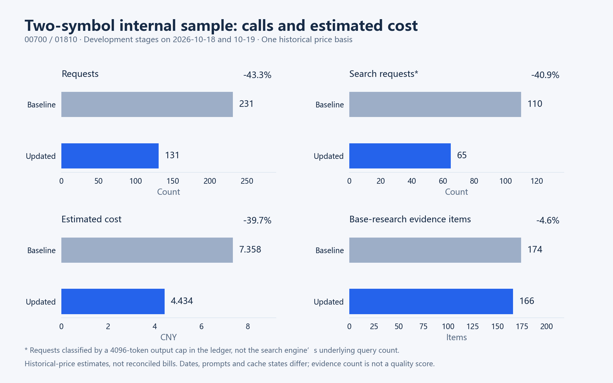

# AI-Driven Global Portfolio Optimization & Multi-Agent Trading Automation System — Quantitative and AI Investment Logic

[Back to README](../README_EN.md) · [简体中文](INVESTMENT_LOGIC.md)

Methods and default parameters in this document correspond to 2.3.0 / `5c1d395`. Effective values depend on user-selected mandates, configuration and market constraints.

AI Trading Automation connects multi-factor quantitative ranking, AI evidence research, portfolio allocation and paper execution across China A-shares, Hong Kong stocks, U.S. equities and exchange-traded funds.

**Quantitative methods identify candidates. AI tests investment theses. Allocation rules shape portfolio proposals. Code-based risk checks constrain execution.**

## How quantitative methods and AI work together



A high quantitative score gives a stock research priority. AI examines technical, financial, news and sentiment material, assesses the opportunity and counterevidence, and proposes stock-level and portfolio decisions. Cash rules can subsequently change actions and target weights; all proposed orders still pass independent risk checks.

The portfolio optimizer independently provides allocation, risk and rebalancing-cost references for the assistant to retrieve and interpret. WATCH is a research state: the execution boundary treats it as HOLD, without automatic price-triggered orders.

<details>
<summary>Research orchestration and reuse parameters</summary>

| Parameter | Current configuration or rule |
|---|---|
| Base research | 4 analyst perspectives per symbol |
| Minimum citation gate | At least 1 citation per valid base-research result |
| Symbol research success ratio | At least 80% |
| Research debate / risk debate | 1 round each by default |
| Default role-task count | 8 × symbol count + 6; 4 symbols produce 38 tasks |
| Shared research data TTL setting | 30 minutes |
| Default exact-query cache TTL | 24 hours; keyed by market, symbol, normalized query and date |

</details>

## Nine-factor scoring and candidate ranking



Each factor maps to a 0–100 score. The base score includes all nine factors; the potential score emphasizes momentum, relative performance and price/volume changes.

```text
Base score = Σ(factor score × configured weight) / Σ(configured weight)
Potential score = 32% × momentum + 26% × relative strength + 16% × volume breakout
                + 12% × acceleration + 14% × risk-adjusted momentum
Final ranking score = 55% × potential score + 45% × base score
```

<details>
<summary>Factor definitions and screening parameters</summary>

| Factor | Default base weight | Calculation |
|---|---:|---|
| Momentum | 25% | Average of mapped 5-day and 20-day price changes |
| Relative strength | 20% | 20-day return deviation from the current candidate sample median |
| Trend | 12% | MA5/10/20 alignment, price versus MA20/60, MACD and RSI14 |
| Volume breakout | 12% | Joint mapping of 5-day price change and volume ratio |
| Acceleration | 8% | Mapped difference between 5-day and 20-day price changes |
| Risk-adjusted momentum | 8% | 20-day return divided by recent volatility, then mapped |
| Liquidity | 7% | Turnover percentile within the current preselected candidate sample |
| Valuation | 4% | Current absolute PE/PB bands; no historical valuation percentile or industry neutralization |
| Low volatility | 4% | Inverse mapping of recent volatility |

| Parameter | Current setting |
|---|---:|
| Market-discovery count parameter | 500 |
| Detailed snapshot prefetch cap | 60 symbols |
| Default shortlist | 8 symbols |
| Configured autonomous research universe cap | 30 symbols |
| Screening refresh interval | 30 minutes |
| Shared research data TTL setting | 30 minutes |
| A-share minimum price / turnover / market cap | CNY 3 / CNY 100 million / CNY 5 billion |
| A-share growth-supplement query | Revenue growth >15% YoY and net-profit growth >15% YoY |

</details>

Scores rank candidates; they are not probabilities of a price increase. Actual candidate counts depend on data coverage, screening results and existing holdings.

## Recorded cases: research outcomes and execution boundaries



These cases are recorded historical runs. This page does not initiate new model analysis or trades. October 5 is a historical research case; October 23 contains development-validation runs. They are not a same-version A/B comparison, and changes in actions do not establish improved investment judgment or returns.

### Case 1: four Hong Kong stocks remain HOLD after completed research

**Date: 2026-10-05.** Cycle `hk-manual-20261005-1458`, symbols `01888 / 00700 / 09988 / 01299`.

38 role tasks completed five research stages, with 185 evidence items and 0 failed tasks. Recorded stage times were 118 → 190 → 16 → 52 → 25 seconds, totaling 401 seconds without startup and other overhead. All four stocks remained HOLD, with status `ready_for_execution` and `submit=false`.

The case shows that completed research can conclude with no new entry. It is not a profit example or a representative timing benchmark for the current version.

<details>
<summary>Expand the original full case figure</summary>



</details>

### Case 2: Quectel — making an observation plan explicit

**Date: 2026-10-23, development validation.** Cycle `20261023-cn-manual-dd365500`.

| Archived field | Recorded value |
|---|---:|
| Symbol / action | 603236 Quectel / WATCH |
| Target weight / confidence | 0% / 0.55 |
| 20-day / 60-day scenario return | −2.60% / −1.40% |
| Watch trigger / validity | CNY 76.11 / 10 days |
| Invalidation / stop-price assumption | CNY 73.02 |
| Evidence items in the round | 84 |

The trader, risk manager and final archive all retained WATCH. The plan has reviewable price and time conditions, but reaching CNY 76.11 would not automatically fill an order. No order was submitted. These prices are outputs from that historical run, not current quotes or current trading recommendations.

### Case 3: Mindray — separating model opinions, allocation rules and fills

**Date: 2026-10-23, development validation.** Cycle `20261023-cn-manual-50108623`.

| Stage | Recorded result |
|---|---|
| Trader proposal | WATCH, target weight 0%, confidence 0.60 |
| Risk-manager proposal | BUY, target weight 5%, confidence 0.60 |
| Final archive after cash rules | BUY, target weight 12%, `forced_deployment=true` |
| Final 20-day / 60-day scenario return | +0.15% / +4.06% |
| Evidence items in the round | 85 |
| Submission and execution | `submit=false`, awaiting approval; no submitted order or paper-fill receipt |

The case shows that portfolio construction and code-based allocation rules can change a proposal. The 12% figure is a proposed weight, not a filled position. Any later submission must be checked against the effective market-specific per-stock position cap, per-order value, available cash and other constraints.

## Portfolio optimization and strategy parameters

Mean–variance, Black–Litterman, risk-parity and cost-adjusted schemes provide independent allocation references. Outputs include weights with cash, historical return and volatility estimates, VaR95, average tail loss, drawdown and rebalancing costs. Current Black–Litterman views use historical means and configured confidence, not AI-generated return forecasts; search and iteration are numerical approximations.

| Optimizer parameter | Current default |
|---|---:|
| Lookback parameter | 120 days |
| Minimum common price observations | 31, producing at least 30 return observations |
| Maximum symbols per optimization | 12 |
| Maximum-Sharpe search sample parameter | 3,000 |
| Assumed annual risk-free rate | 2% |
| Black–Litterman τ / view confidence | 0.05 / 0.50 |
| Risk aversion / runtime limit | 2.50 / 180 seconds |
| Cost adjustment | Enabled |

| Mandate parameter | Conservative | Neutral | Aggressive |
|---|---:|---:|---:|
| Total position cap | 55% | 75% | 95% |
| Minimum cash reserve | 45% | 25% | 5% |
| Strategy per-stock cap | 8% | 12% | 20% |
| Per-order value cap as a share of equity | 3% | 5% | 8% |
| Minimum decision confidence | 0.75 | 0.60 | 0.55 |
| Per-cycle turnover cap | 10% | 20% | 40% |
| Maximum orders per cycle / trades per day | 2 / 4 | 3 / 6 | 5 / 10 |
| Maximum-drawdown trigger | −8% | −12% | −18% |

These are mandate definitions, activated by explicit user strategy selection and combined with market settings. For example, the current A-share market's per-stock position cap is 10%, so the effective neutral cap is `min(12%, 10%) = 10%`; each order is additionally limited by the 5% per-order value cap.

The current cash-deployment function triggers above the minimum cash reserve plus 5 percentage points, corresponding to cash above 30% for the neutral mandate, and requires at least one candidate with a positive 20-day or 60-day expected return. It then attempts to supplement deployment proposals. Prompts separately use a cash-above-25% requirement; these thresholds currently differ and should not be presented as one unified rule. Deployment proposals do not compel a fill.

## Internal efficiency sample: ledger counts and cost estimates



This sample compares two development stages for 00700 and 01810: baseline cycle `20261018-hk-manual-d6321b31` and updated cycle `20261019-hk-manual-78931730`.

| Metric | Baseline | Updated | Change |
|---|---:|---:|---:|
| Requests | 231 | 131 | −43.3% |
| Search requests classified by a 4096-token cap | 110 | 65 | −40.9% |
| Base-research evidence items | 174 | 166 | −4.6% |
| Estimated cost on the same price basis | CNY 7.358 | CNY 4.434 | −39.7% |

Costs were recalculated from raw usage tokens using one historical price basis per million tokens: CNY 0.04 cached input, CNY 2 uncached input and CNY 8 output. These are not current-price claims or reconciled provider bills. Dates, prompts and cache states differ; the results are not single-factor causal evidence or all-market averages. Search-request counts are not underlying search-engine query counts, and evidence-item counts do not establish complete factual coverage or equivalent research quality.

## Implementation and validation boundaries

Implementation references: [screening engine](../engine/screening/engine.py), [portfolio optimization](../engine/optimizer/runner.py), [strategy mandates](../engine/investment/mandate.py), [risk checks](../engine/trading/risk.py), [paper broker](../engine/trading/broker.py), and [shared research data](RESEARCH_DATA_PIPELINE.md).

The repository also has a lightweight momentum-rule backtest with simplified price and cost assumptions. It does not replay the complete multi-agent strategy or all paper-broker rules. Full strategy evaluation still requires point-in-time data, out-of-sample intervals, benchmarks, costs and execution assumptions.

### Checking the recorded cases

- Method parameters come from current code and configuration. Case values belong to the specified historical rounds, with research and development-validation cases labeled separately.
- The [minimal case summary](assets/quant-ai-cases.json) retains cycles, stage actions, statuses and chart values. It excludes account balances, complete holdings, credentials, raw conversations and full research material.
- Development cases are not complete acceptance evidence for the 2.3.0 installer. BUY proposals are not fills or realized returns.

> This project supports investment research and paper trading only, without a live-broker connection. Factor scores, historical optimizer metrics and model scenario estimates do not guarantee returns.
